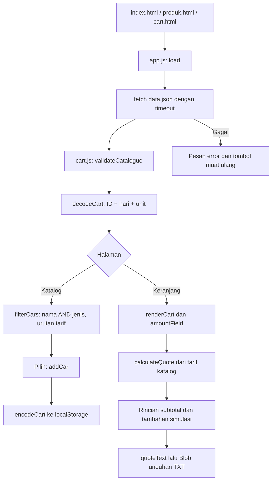

# Alur kode Sewa Mobil

Ketiga halaman memuat modul `js/app.js`. `setupNavigation()` menyiapkan menu sempit dan tema. `load()` mengambil `data.json`, menjalankan `validateCatalogue()`, lalu membaca keranjang melalui `decodeCart()` sebelum menampilkan katalog atau rincian estimasi.

## Sumber harga dan keranjang

`js/cart.js` adalah modul aturan tanpa DOM. `validateCatalogue()` membatasi ID, kategori, bilangan tarif dan path gambar lokal. `decodeCart()` menerima versi format yang dikenali, memulihkan baris valid, dan membuang ID asing/duplikat serta hari/unit di luar batas. Harga, nama, dan gambar dari storage tidak ikut disalin.

`addCar()` menambah satu baris per ID, dengan hari dan unit awal satu. `encodeCart()` hanya menyimpan ID, hari, dan unit. Perubahan data dari tab lain ditangani event `storage` di `js/app.js`. Bila penyimpanan gagal, state tetap berada dalam memori tab dan pemberitahuan menjelaskan batasnya.

## Katalog dan estimasi

`renderCatalogue()` memakai `filterCars()` untuk gabungan pencarian/jenis dan urutan harga numerik. DOM dibentuk melalui `createElement` dan `textContent`; nilai katalog/storage tidak dijalankan sebagai HTML. Mobil terpilih ditautkan ke keranjang agar klik berulang tidak menaikkan jumlah unit tanpa terlihat.

`amountField()` memeriksa bilangan bulat dan batas hari/unit sebelum memperbarui state. Isian tidak valid mempertahankan nilai hitungan terakhir, menampilkan pesan, dan menonaktifkan unduhan sampai diperbaiki. `calculateQuote()` menghitung setiap tarif × hari × unit, kemudian menjumlahkannya dengan tambahan simulasi 10%. `quoteText()` memakai hasil hitungan yang sama untuk unduhan sehingga angka di file dan UI tidak berbeda.

## Halaman dan server

`index.html` menjelaskan lingkup demo; `produk.html` adalah katalog; `cart.html` adalah perincian lokal. Tidak ada endpoint reservasi atau pembayaran. `scripts/serve.js` hanya melayani GET/HEAD untuk daftar aset tertentu, dengan header tipe konten dan kebijakan resource lokal. Tidak ada pembacaan folder arbitrer.

`test/cart.test.js` menguji aturan dari modul yang sama dengan UI, termasuk kasus penyimpanan rusak dan harga browser yang diganti. Pengujian browser terpisah mencakup navigasi, formulir, pemuatan gagal/pulih, unduhan, keyboard, dan tata letak kedua tema.
