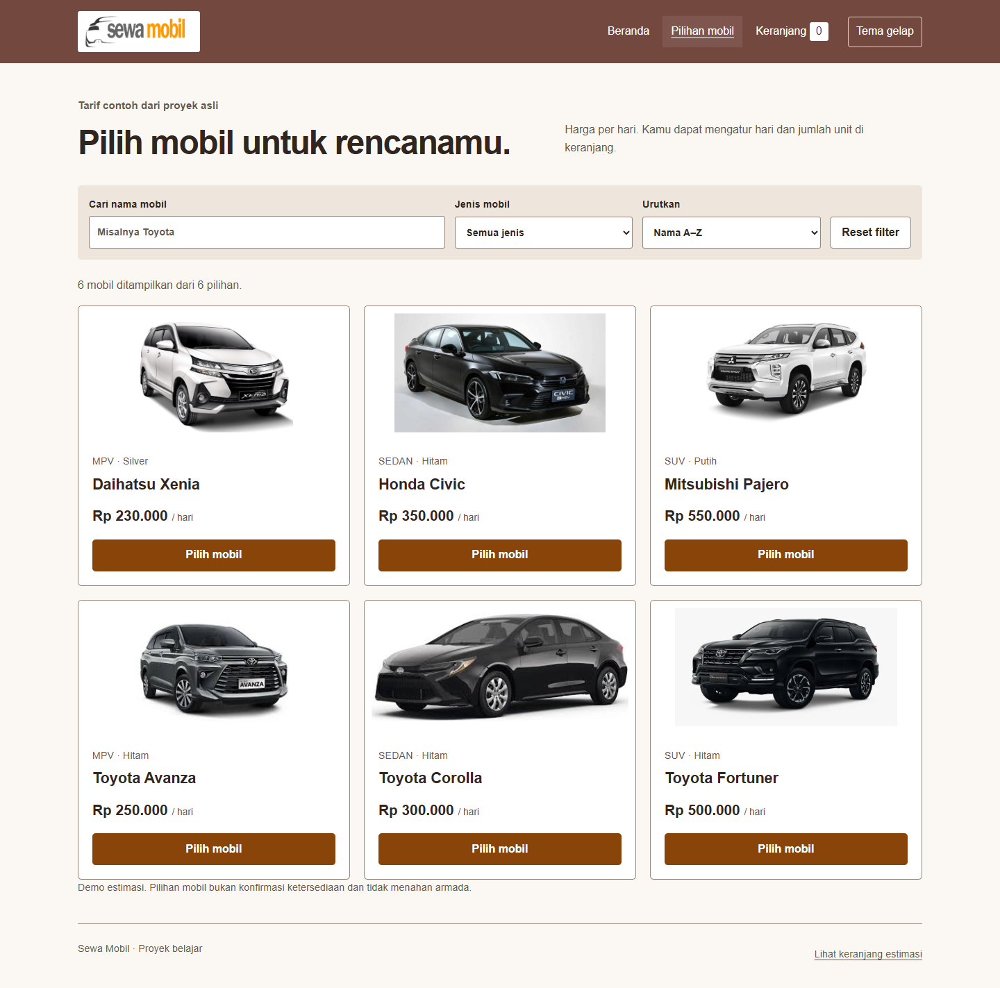
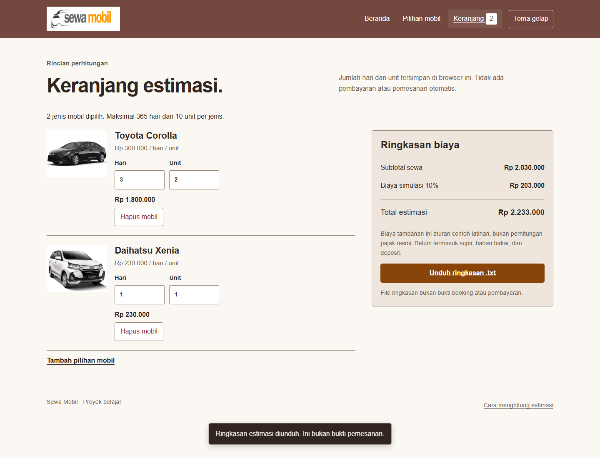

# Sewa Mobil

Demo katalog dan estimasi rental mobil dengan HTML, CSS, dan JavaScript. Bandingkan enam mobil, pilih armada, atur jumlah hari dan unit, lalu unduh rincian biaya sebagai file teks.





Screenshot diambil dari aplikasi lokal menggunakan data contoh proyek. **Aplikasi ini menghitung estimasi; tidak memesan armada atau menerima pembayaran.** Tarif dan tambahan 10% adalah contoh latihan, bukan harga layanan aktif atau perhitungan pajak resmi.

## Menjalankan

Gunakan Node.js 22.13+ dari seri 22, atau Node.js 24+. Tidak ada dependency npm yang perlu dipasang.

```powershell
git clone https://github.com/zalamanga/rental-car.git
cd rental-car
npm start
```

Buka `http://127.0.0.1:8095`. Untuk port lain, jalankan `$env:PORT = '8096'` sebelum `npm start`. Server pengembangan hanya mendengarkan loopback. Tekan Ctrl+C untuk berhenti.

Jalankan melalui HTTP agar browser bisa memuat `data.json` dan modul JavaScript. Membuka file HTML langsung lewat `file://` tidak didukung. Untuk hosting statis, unggah tiga HTML, `data.json`, `css/`, `js/`, dan gambar yang dipakai. Script server lokal memakai daftar berkas publik; README, tes, dan konfigurasi Git tidak tersedia sebagai endpoint.

## Mencoba aplikasi

1. Buka **Pilihan mobil**. Gabungkan pencarian nama dan jenis mobil; urutkan menurut nama atau tarif.
2. Tekan **Pilih mobil**. Mobil yang sudah dipilih memiliki tautan **Lihat di keranjang**, sehingga pilihan tidak terduplikasi tanpa sengaja.
3. Di **Keranjang**, atur hari (1–365) dan unit (1–10) untuk setiap jenis mobil. Batas unit adalah batas simulasi, bukan informasi stok armada.
4. Periksa subtotal per mobil dan biaya tambahan simulasi. Tekan **Unduh ringkasan .txt** untuk menyimpan rincian.

Rumus setiap mobil adalah `tarif harian × hari × unit`. Subtotal seluruh mobil ditambah biaya simulasi 10%. Supir, bahan bakar, deposit, jadwal, dan ketentuan pembatalan belum dihitung. Menghapus mobil atau mengubah hari langsung memperbarui estimasi.

## Data dan batas penyimpanan

Keranjang disimpan di `localStorage` dengan key `rental-car:cart:v1`. Data berisi ID mobil, hari, dan unit; nama, gambar, serta tarif selalu dibaca dari katalog. Harga yang disisipkan ke data browser tidak dijadikan dasar hitungan. Ini bukan perlindungan transaksi: pemilik browser tetap dapat mengubah seluruh aplikasi, dan tidak ada server pemesanan.

Pilihan tetap ada setelah reload dan tersinkron antar tab pada origin yang sama. Jika isi penyimpanan rusak, aplikasi mempertahankan baris yang valid dan menampilkan pemberitahuan. Jika browser menolak penyimpanan, estimasi masih dapat dibuat dalam tab saat ini; perubahan dapat hilang saat pindah halaman. Unduh ringkasan sebelum menutup tab tersebut.

Data lama `list_belanja` dari proyek awal tidak dibaca atau dihapus, karena formatnya menyimpan harga dan struktur yang berbeda. Tidak ada migrasi diam-diam. Tema terang/gelap mempunyai preferensi tersendiri; berkas unggahan, akun, dan data kontak tidak diperlukan.

## Struktur dan tes

```text
index.html         pengantar dan penjelasan estimasi
produk.html        filter dan katalog
cart.html          isian hari/unit serta unduhan
data.json          enam mobil dan tarif contoh
js/cart.js         validasi, penyimpanan, filter, dan rumus
js/app.js          DOM, pemuatan data, navigasi, tema, unduhan
css/style.css      tata letak dan kedua tema
scripts/serve.js   server HTTP lokal dengan daftar berkas publik
test/cart.test.js  tes aturan katalog dan keranjang
```

```powershell
npm run check
```

Tes mencakup filter gabungan, urutan tarif, keranjang lintas halaman, hari/unit, penyimpanan rusak, harga yang dimanipulasi, batas input, dan isi unduhan. Rincian hubungan UI dan fungsi ada di [CODE_FLOW.md](CODE_FLOW.md). Asal source serta aset tercatat di [NOTICE.md](NOTICE.md).
